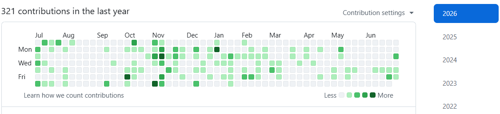

# Hi, I'm Hifzha 'Ilman 👋

### Website Developer | PHP (Laravel) & React.js

Saya membangun aplikasi web yang terstruktur, cepat, mudah dikembangkan, dan relevan dengan kebutuhan bisnis.

---

## About Me

Saya adalah **Web Developer** yang berfokus pada pengembangan aplikasi berbasis **PHP**, terutama menggunakan framework **Laravel**, serta **React.js** untuk membangun antarmuka yang interaktif dan responsif.

Saya senang mempelajari teknologi baru, menerapkan arsitektur aplikasi modern, dan membangun sistem yang mengutamakan **performa, skalabilitas, keamanan, kemudahan pemeliharaan, serta pengalaman pengguna**.

Saya memiliki pengalaman mengerjakan berbagai proyek akademis, freelance, dan perusahaan, termasuk pengembangan sistem berbasis web, integrasi **REST API**, pengelolaan basis data, autentikasi dan otorisasi, serta implementasi proses bisnis sesuai kebutuhan pengguna.

## Currently Focusing On

- Pengembangan web application tingkat lanjut, seperti **Point of Sale (POS)** dan **Software as a Service (SaaS)**
- **State management** dan arsitektur aplikasi yang terstruktur serta mudah dikembangkan
- Optimalisasi performa aplikasi, database, dan proses backend
- Penerapan **clean code**, design pattern, testing, dan development best practices

## Experience Highlights

- **Web Developer** untuk proyek akademis, freelance, dan perusahaan
- Pemateri kelas tambahan **Web Development** di universitas
- Mengembangkan aplikasi berdasarkan kebutuhan operasional dan proses bisnis
- Mengintegrasikan aplikasi dengan REST API dan layanan pihak ketiga

## Tech Stack

  
  
  
  
  
  
  

## GitHub Statistics

### 321 contributions in the last year

  

---

### Build useful products, write maintainable code, and keep improving.

